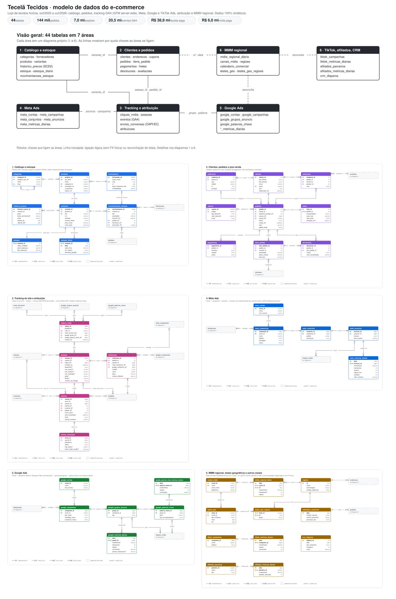

# Tecelã Tecidos: dados sintéticos de um e-commerce de tecidos

[](docs/diagramas/modelo_de_dados_one_pager.svg)

<sub>O modelo inteiro numa página. Clique para ampliar ou baixe em [PNG](docs/diagramas/modelo_de_dados_one_pager.png) e [PDF](docs/diagramas/modelo_de_dados_one_pager.pdf). Cada área tem o diagrama detalhado em [`docs/diagrama_er.md`](docs/diagrama_er.md).</sub>

A **Tecelã Tecidos** é uma loja online brasileira de tecidos **fictícia**, que vende para pessoas que costuram por hobby, costureiras, ateliês e pequenas confecções. Este repositório gera o banco de dados completo da loja entre **01/10/2023 e 13/10/2026**:

- catálogo, preços e estoque diário;
- clientes, pedidos, pagamentos, fretes e devoluções;
- tracking do site (sessões e eventos GA4 via GTM server-side, envios à Meta CAPI);
- mídia paga (Meta, Google e TikTok Ads, até o nível de anúncio e de palavra-chave), afiliados, CRM e atribuição;
- camada de MMM: mídia por UF, calendário comercial e testes geográficos.

O objetivo é praticar análise de marketing e de e-commerce com dados que têm cara de produção: CAC, ROAS, MER, LTV, funil, RFM, previsão de demanda, churn e incrementalidade de mídia.

Tudo é inventado: produtos, fornecedores, campanhas, pessoas, e-mails (domínio `example`), CPFs, telefones e endereços. Os dados pessoais foram gerados do zero com Faker `pt_BR` (CPFs e CNPJs têm o formato oficial, mas dígito verificador inválido de propósito), e `scripts/varredura_pii.py` confere que nenhum dado pessoal real foi parar no banco.

**Dataset pronto para uso no Kaggle:** [ecommerce-sintetico-midia-paga](https://www.kaggle.com/datasets/arielabade/ecommerce-sintetico-midia-paga), com as 44 tabelas em Parquet e uma tabela de mídia consolidada (CPM, CTR, CPC, ROAS).

## Conteúdo

| Caminho | O que é |
|---|---|
| `gerador/` | Processo gerador (Python). `python -m gerador` cria os CSVs. |
| `schema.sql` | DDL MySQL 8: 44 tabelas, PKs, FKs e índices. |
| `docker-compose.yml`, `docker/mysql/` | Sobe o MySQL 8 e carrega os CSVs na primeira inicialização. |
| `dbt/` ([README](dbt/README.md)) | Modelos dbt: limpeza (`staging`), funil por sessão (`intermediate`) e tabelas analíticas (`marts`), com testes. |
| `sql/analises/` ([README](sql/analises/README.md)) | 9 consultas comentadas: CAC/ROAS/MER, coortes, funil, RFM, curva ABC, atribuição, limpeza do tracking, ruptura de estoque. |
| `notebooks/` ([README](notebooks/README.md)) | 5 notebooks de modelagem (abaixo). |
| `docs/dicionario_dados.md` | Dicionário de dados: grão e descrição de cada tabela e coluna. |
| `docs/diagrama_er.md`, `docs/diagramas/` | Diagramas entidade-relacionamento por área e o one-pager (SVG, PNG e PDF), gerados por `scripts/gerar_diagramas.py`. |
| `docs/imperfeicoes.md` | Imperfeições inseridas de propósito, com como detectar e tratar cada uma. |
| `scripts/validar.py` | Integridade referencial, regras de negócio e faixas de métricas. |
| `data/verdade/` | **Gabarito** do gerador: efeito real de cada canal de mídia, motor de cada pedido, demanda perdida por ruptura. Não vai para o MySQL. |

## Modelo de dados

São **44 tabelas em 7 áreas**. Cada área tem um diagrama próprio, sem linhas cruzadas, com as chaves (PK/FK), os tipos e a cardinalidade em notação pé de galinha:

| Área | Tabelas | Diagrama |
|---|---|---|
| Catálogo e estoque | categorias, fornecedores, produtos, variantes, historico_precos (SCD2), estoque, estoque_diario, movimentacoes_estoque | [1](docs/diagrama_er.md#1-catálogo-e-estoque) |
| Clientes e pedidos | clientes, enderecos, cupons, pedidos, itens_pedido, pagamentos, fretes, devolucoes, avaliacoes | [2](docs/diagrama_er.md#2-clientes-pedidos-e-pós-venda) |
| Tracking e atribuição | cliques_midia, sessoes, eventos, envios_conversao, atribuicoes | [3](docs/diagrama_er.md#3-tracking-do-site-e-atribuição) |
| Meta Ads | meta_contas, meta_campanhas, meta_conjuntos, meta_anuncios, meta_metricas_diarias | [4](docs/diagrama_er.md#4-meta-ads) |
| Google Ads | google_contas, google_campanhas, google_grupos_anuncio, google_palavras_chave e as duas tabelas de métricas diárias | [5](docs/diagrama_er.md#5-google-ads) |
| MMM regional e outros canais | midia_regional_diaria, canais_midia, regioes, calendario_comercial, testes_geo, testes_geo_regioes, tiktok_*, afiliados_*, crm_disparos | [6](docs/diagrama_er.md#6-mmm-regional-testes-geográficos-e-outros-canais) |


Os diagramas são gerados a partir do `schema.sql` por `python scripts/gerar_diagramas.py`, que falha se alguma linha cruzar outra ou atravessar uma tabela.

## Volume (escala 1.0)

| Tabela | Linhas |
|---|---:|
| `clientes` | 51.179 |
| `pedidos` / `itens_pedido` | 144.583 / 270.242 |
| `sessoes` | 7.027.410 |
| `eventos` | 20.450.741 |
| `cliques_midia` | 2.758.328 |
| `estoque_diario` | 2.275.191 |
| `meta_metricas_diarias` / `google_metricas_diarias` / `tiktok_metricas_diarias` | 17.677 / 13.659 / 3.204 |
| `midia_regional_diaria` | 255.096 |

Receita paga de R$ 38,9 milhões, ticket médio de R$ 288 e investimento em mídia paga de R$ 6,0 milhões (Meta, Google, TikTok e afiliados), MER de 6,4.

## Como rodar

Requisitos: Python 3.11+, Docker com Compose v2 e ~25 GB livres em disco (CSVs + volume do MySQL + arquivos temporários do dbt).

```bash
make ambiente     # cria .venv e instala requirements.txt
make dados        # gera os CSVs em data/csv (~13 min; ESCALA=0.05 make dados para uma amostra de ~1 min)
make mysql        # sobe o MySQL e carrega os CSVs; só fica "healthy" quando a carga termina
make dbt          # modelos e testes do dbt, dentro de um container
make validar      # checagens de integridade e das imperfeições esperadas
make notebooks    # executa os 5 notebooks
make dicionario   # regenera docs/dicionario_dados.md
```

`make tudo` roda a sequência de `dados` a `notebooks`. `make limpar` derruba o MySQL e apaga o volume (os CSVs ficam).

- **Conexão:** `localhost:3336`, banco `tecidos`, usuário `analista` / senha `analista123` (root: `tecidos_root`). Para mudar, copie `.env.example` para `.env`.
- **Memória:** o InnoDB usa 1 GB por padrão (`MYSQL_BUFFER_POOL`). Com pouca RAM livre, rode o dbt com `--threads 1`.
- **Gráficos dos notebooks:** saem em PNG pelo `kaleido`, que precisa de um Chrome. Rode `plotly_get_chrome` uma vez ou aponte `BROWSER_PATH` para um Chrome/Chromium instalado. Sem Chrome, os gráficos saem em HTML interativo, que o GitHub não exibe.

## Notebooks

| Notebook | Pergunta |
|---|---|
| `01_previsao_demanda_receita` | Quantos pedidos e quanta receita esperar nos próximos meses, incluindo a Black Friday de 2026? |
| `02_churn_propensao_recompra` | Quais clientes têm mais chance de não voltar a comprar em 90 dias, e quanto vale agir sobre eles? |
| `03_segmentacao_clientes` | Que grupos de clientes existem pelo comportamento de compra, e eles batem com o tipo declarado no cadastro? |
| `04_ltv_preditivo` | Quanto cada cliente vai gerar em 12 meses e qual o CAC máximo por canal? |
| `05_incrementalidade_mmm` | Quantos pedidos cada canal de mídia gera de verdade? Teste de pausa + MMM calibrado, comparados com o gabarito. |

## Contexto do negócio

- **Clientes:** hobby, costureira, ateliê e confecção, pessoas físicas e jurídicas. Tecidos são vendidos por metro ou em rolo.
- **Sazonalidade:** Volta às Aulas, Dia do Consumidor (15/03), Dia das Mães, Dia da Costureira (25/05), Festa Junina (chita e xadrez), Black Friday e Natal. Linho e viscose vendem mais no calor.
- **Mídia:** Meta (prospecção, remarketing, campanhas sazonais e testes) e Google (Search de marca e genérico, Shopping, PMax, Demand Gen). Toda a prospecção da Meta ficou pausada de 04 a 24/08/2025, como teste de incrementalidade.
- **Tracking:** GTM server-side com Consent Mode v2; o purchase sai do navegador e do servidor. Os problemas que isso causa estão em `docs/imperfeicoes.md`.
