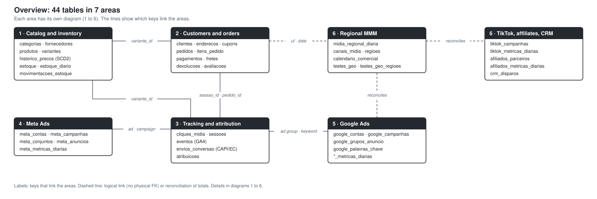
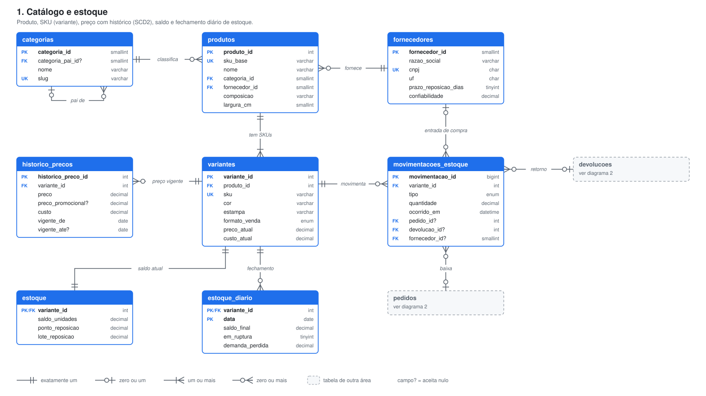
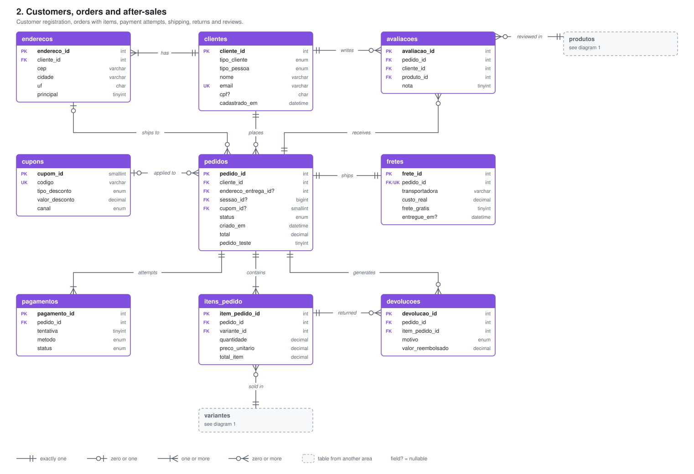
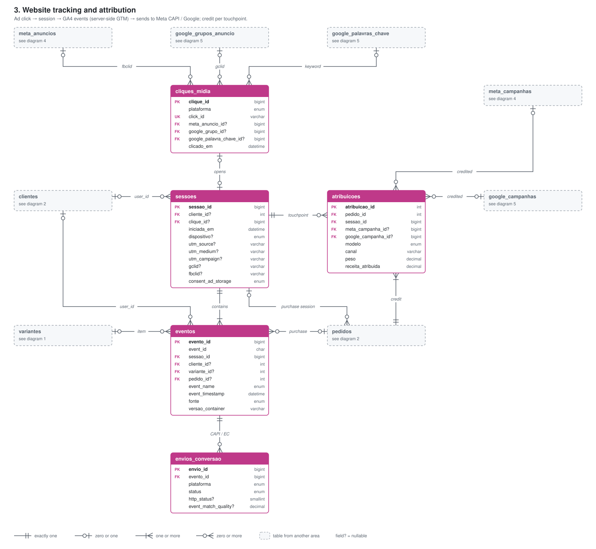
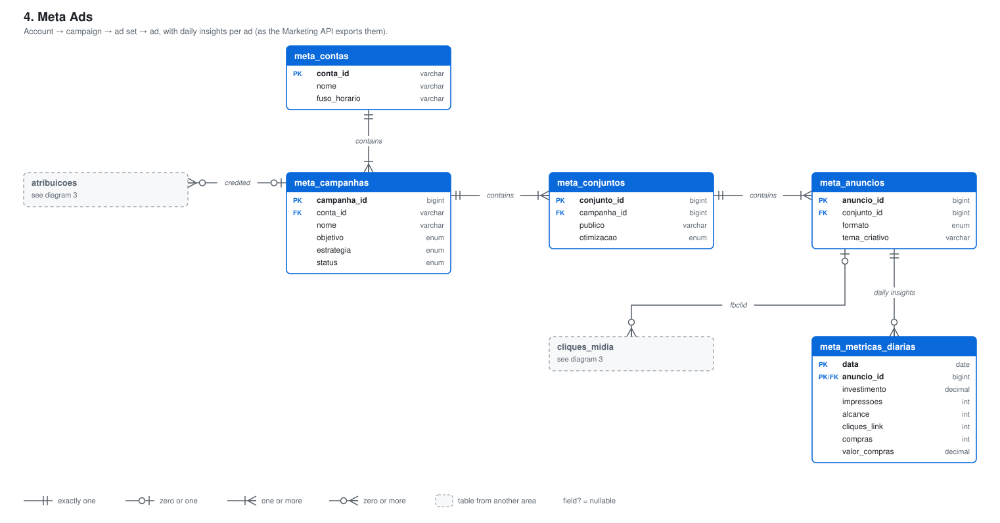
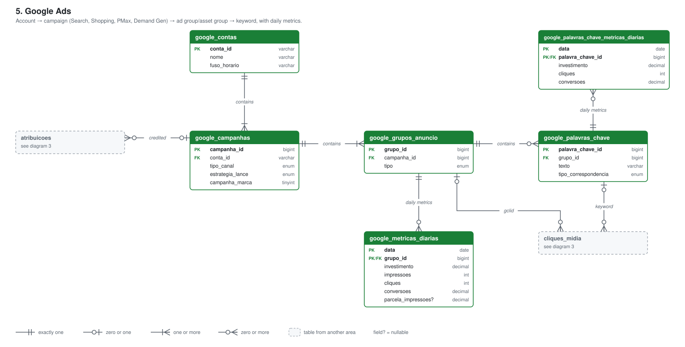
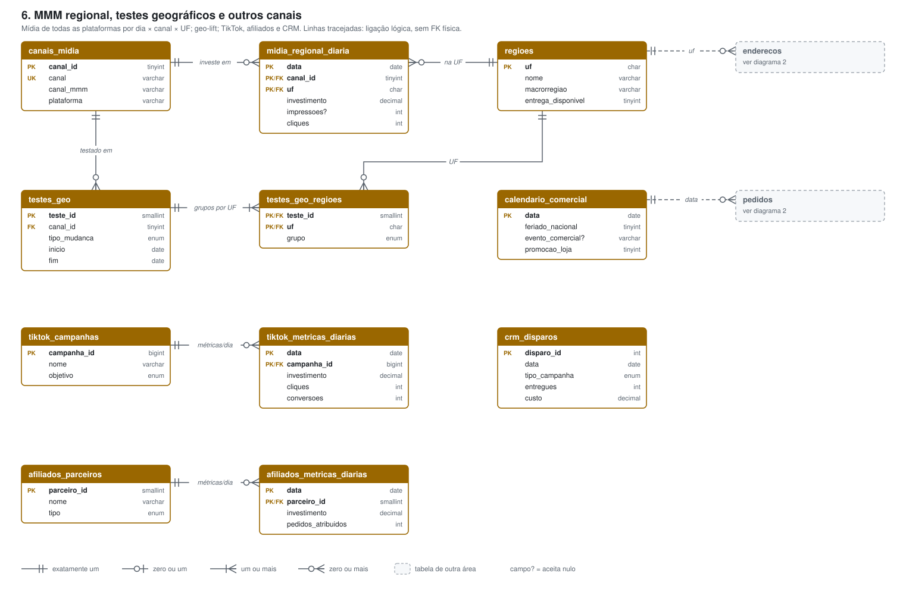

# Analytical layer (dbt)

The models clean the raw MySQL tables and build the analysis tables. Run them with `make dbt` (inside a container, with
the tests). Each layer's tests are in the `_*.yml` files and in [`tests/`](tests/).

| Layer | Model | What it does | Source area |
|---|---|---|---|
| staging | `stg_clientes` | Normalized e-mail, phone in E.164 and duplicate accounts of the same person (same CPF) unified | [2](#2-customers-and-orders) |
| staging | `stg_pedidos`, `stg_itens_pedido` | Real orders (no tests), local time and UTC side by side; items with product and category | [1](#1-catalog-and-inventory) · [2](#2-customers-and-orders) |
| staging | `stg_sessoes`, `stg_eventos` | Normalized UTMs; events without duplicates (`event_id` and `transaction_id`) and with the time zone fixed | [3](#3-tracking-and-attribution) |
| staging | `stg_midia_diaria` | Meta, Google, TikTok and affiliates stacked at the date × platform × campaign grain | [4](#4-meta-ads) · [5](#5-google-ads) · [6](#6-regional-mmm-and-other-channels) |
| staging | `mmm/stg_*` | Channels, regions, regional media, calendar and geo tests | [6](#6-regional-mmm-and-other-channels) |
| intermediate | `int_sessoes_funil` | One row per session, with the default channel and the funnel steps | [3](#3-tracking-and-attribution) |
| marts | `fct_pedidos`, `dim_clientes` | Order with the customer's sequence, cohort, margin and last-click channel; unified customer | [2](#2-customers-and-orders) |
| marts | `fct_midia_diaria`, `fct_kpis_diarios`, `fct_funil_canal_diario` | Spend next to reported and attributed conversions; daily KPIs (revenue, MER, CAC); funnel by channel | [3](#3-tracking-and-attribution) · [4](#4-meta-ads) · [5](#5-google-ads) |
| marts | `mmm/fct_mmm_*`, `mmm/dim_testes_geo` | Sales and media by state and day, controls (calendar, price) and the geo tests | [6](#6-regional-mmm-and-other-channels) |

## Source tables

### 1. Catalog and inventory

### 2. Customers and orders

### 3. Tracking and attribution

### 4. Meta Ads

### 5. Google Ads

### 6. Regional MMM and other channels

