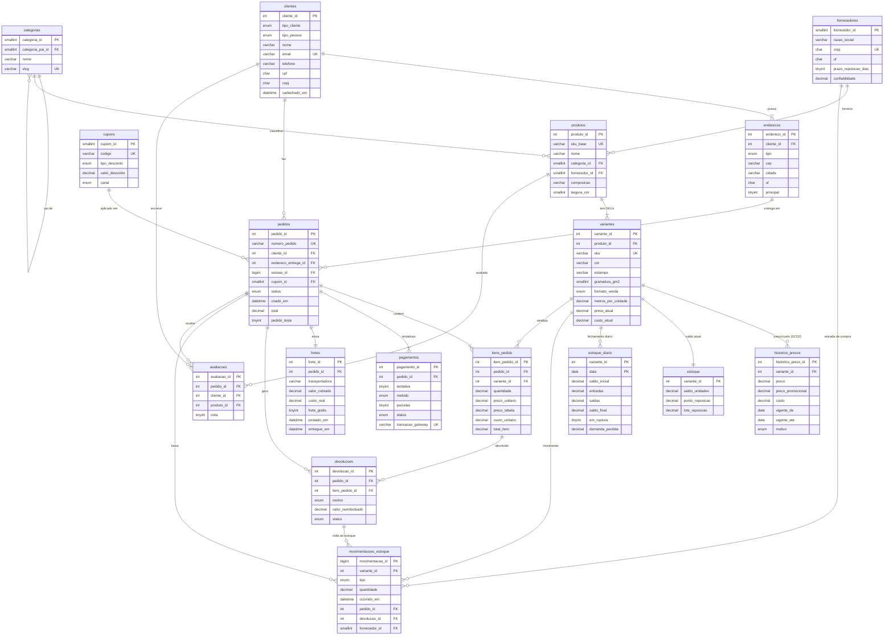
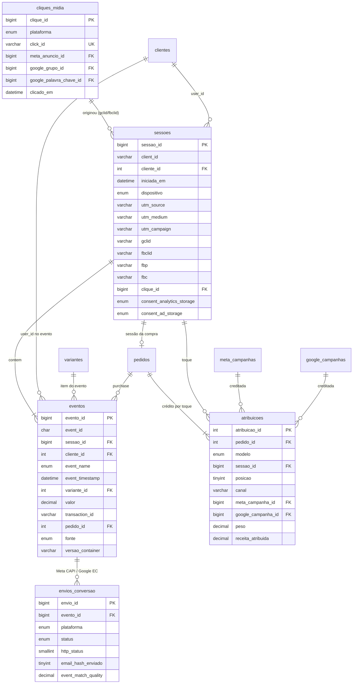
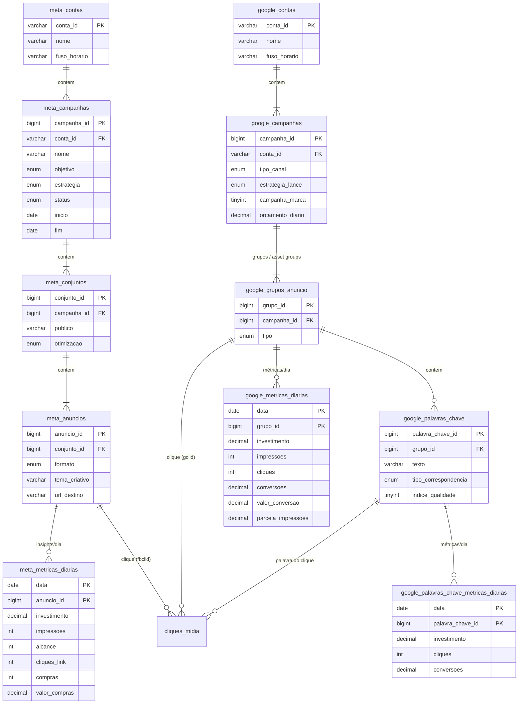
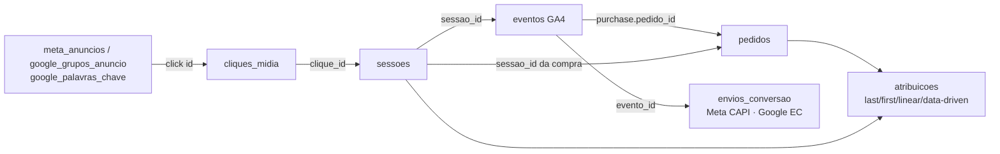

# Diagrama entidade-relacionamento

O GitHub renderiza os blocos Mermaid abaixo. São três vistas do mesmo banco `tecidos`; as chaves estrangeiras atravessam as vistas (por exemplo, `pedidos.sessao_id` liga o transacional ao tracking).

## 1. Transacional (catálogo, estoque, clientes, pedidos)

## 2. Tracking (GTM server-side, GA4) e atribuição

## 3. Mídia paga (Meta Ads e Google Ads)

## Cadeia clique → sessão → pedido

